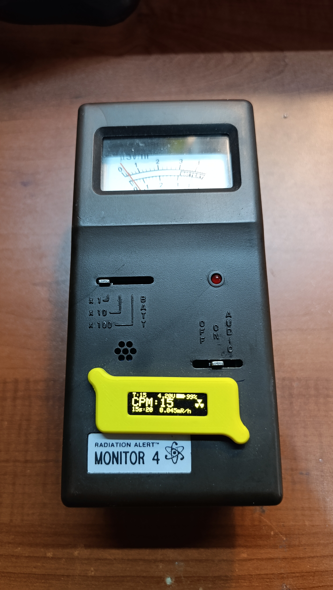
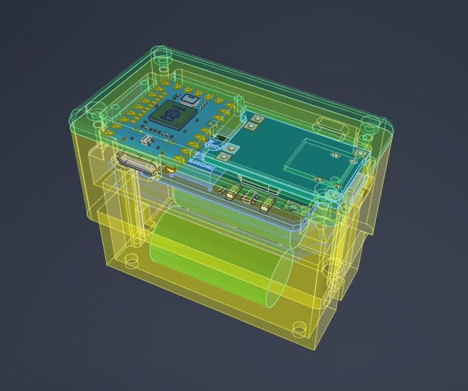
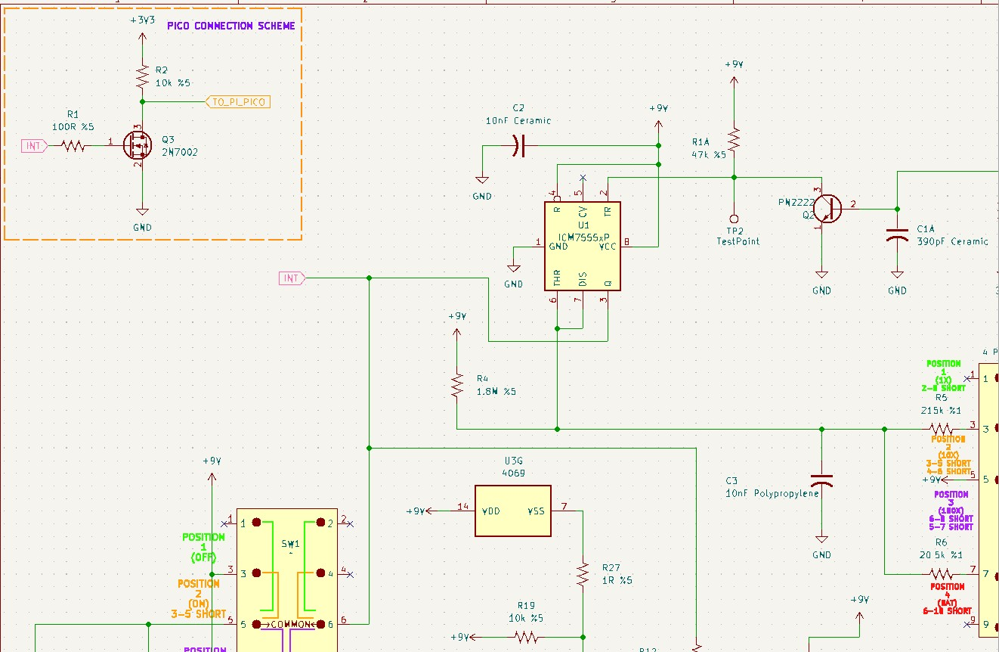
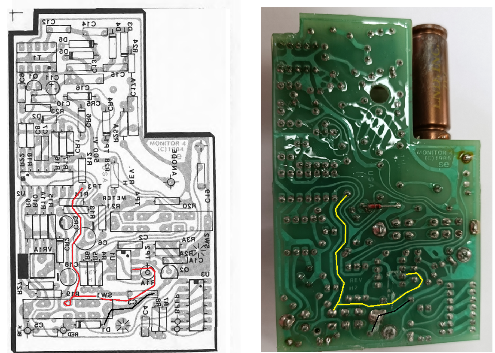
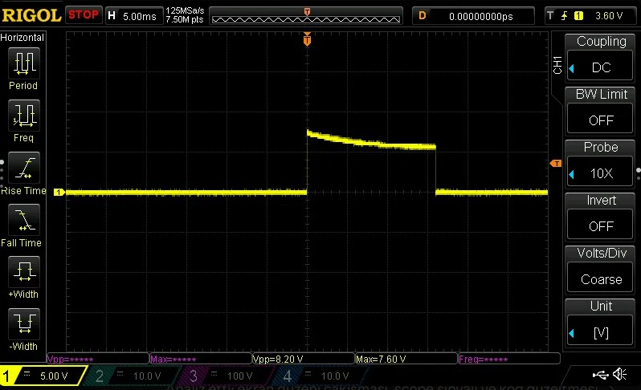

# ☢️ Heathkit Radiation-Monitor (RM-4) Digital Retrofit

> *"If it ain't broke add a microcontroller to it anyway."*

A non-invasive digital upgrade for the classic **Heathkit RM-4 Geiger Counter** — because a bouncing needle is charming, but a 128×32 OLED is charming *and* readable in the dark.

The analog meter still works. The original circuit is untouched. I just eavesdropped on it.

---

## What This Is

The Heathkit RM-4 is a vintage radiation monitor built around an **LND712 Geiger-Müller tube**, a high-voltage multiplier stack and a logarithmic ratemeter driven by an **LM3086** transistor array. It has a beautiful analog milliammeter, a satisfying audible click on each detection event and absolutely zero USB-C ports.

This project adds:

- **SSD1306 0.91" I²C OLED display** showing real-time CPM, dose rate, battery voltage and a geometrically-correct trefoil symbol that flashes on every detected particle
- **Waveshare RP2040-Zero** doing all the number-crunching and stuff
- **Battery voltage monitoring** with low-battery auto-shutdown to protect your LiPo
- **LittleFS flash logging** — CSV data, readable over USB serial
- **Zero modifications to the original circuit** — as a hardware purist guy, the analog meter, speaker click and LED all work exactly as Heathkit intended in 1976





---

## Hardware

### Signal Tap — The Key Insight

The entire digital side listens to a single wire: **U1 pin 3** (ICM7555 monostable Q output).

The RM-4's signal chain goes:







The ICM7555 produces clean, fixed-width (~10–15 ms), CMOS-level pulses — one per radiation event. Scope-verified: Vpp = 8.20 V, no ringing, no bounce. It's the cleanest signal in the whole instrument and it was already there.



### Level Shifter

The 555 lives in the 9 V domain. The RP2040 lives in the 3.3 V domain. A **2N7002 N-channel MOSFET** in open-drain topology bridges them.(You may use a transistor or level shifter if you wish):

- 9 V domain: never touches the RP2040
- Signal inverts (Q high → GPIO low), so firmware uses `FALLING` edge interrupt
- Gate resistor suppresses any switching transients

### Battery Monitor

Voltage divider on **GP26 (ADC0)**:

```
Lipo+ / USB 5V ──[100kΩ]──┬──[100kΩ]── GND
                          │
                        GP26 + 100nF
```

Equal resistors = 1:1 divider (÷2). Safe to 5.5 V input worst-case (2.75 V at ADC, well within the 3.3 V absolute maximum). A calibration factor (`BAT_CAL_FACTOR`) compensates for the RP2040's ADC reference deviation (~3.14 V actual vs 3.3 V assumed).

### Power

- RP2040 + OLED powered from **separate USB / LiPo**
- RM-4 powered from its own **9 V battery (B1)**
- Only **GND is shared** — no current path between the two supplies
- The 3.3 V pull-up on the level shifter comes from the RP2040 side

### Parts List

| Component | Value / Part | Notes |
|---|---|---|
| Microcontroller | Waveshare RP2040-Zero | Arduino-compatible |
| Display | SSD1306 0.91" I²C OLED | 128×32 px |
| Level shifter | 2N7002 N-MOSFET | SOT-23 |
| Gate resistor | 100 Ω | Series, ringing suppression |
| Pull-up resistor | 10 kΩ | Drain → 3V3 |
| Voltage divider | 100 kΩ + 100 kΩ | GP26 ADC input |
| ADC filter cap | 100 nF | GP26 → GND |
| Signal wire | Any fine wire | From ICM7555 pin 3 / SW1 pin 6 |

---

## Display Layout

```
T:1234   4.12V [████░░] 75%
CPM:23                    ☢
15s:18   0.069mR/h
```

| Row | Content | Font size |
|---|---|---|
| 1 (y=0) | Total count · Voltage · Battery icon + % (or "USB") | 1 (8 px) |
| 2 (y=8) | CPM 60-second rolling average | 2 (16 px) |
| 3 (y=24) | 15-second fast CPM · mR/hr dose rate | 1 (8 px) |

The trefoil (☢) appears in the right margin of row 2 for 500 ms after each detected event, then vanishes. It is geometrically correct — computed pixel-by-pixel in Python with proper annular sector math at 90°/210°/330°, not hand-drawn nonsense.

---

## Firmware

### CPM Algorithm — Rolling Window

The naive approach (count pulses over 3 seconds, multiply by 20) gives ±20 CPM jumps and a 3-second lag. We do better:

Every pulse timestamp is stored in a **512-entry ring buffer**. On each display update (every 500 ms), the firmware counts how many timestamps fall within the last N milliseconds — in a single pass that computes both windows simultaneously:

```
60-second window → stable CPM reading (matches the original analog meter behavior)
15-second window → fast-response "instantaneous" CPM
```

**Ramp-up correction:** At boot, the effective window is scaled to the actual elapsed time, so CPM doesn't read artificially low for the first minute.

**Software debounce:** 500 µs minimum inter-pulse gap filters any level-shifter switching noise. The ICM7555 monostable already enforces ~10 ms dead time, so this is a second line of defence.

### Dose Rate

```
mR/hr = CPM × (1 / 330)
```

The conversion factor `CPM_TO_MRHR = 1/330` is a **placeholder** based on typical LND712 sensitivity. Calibrate against the original SW2 range switch positions for accurate readings. Each SW2 position has a different full-scale, so ideally a per-range lookup table should replace the single constant.

### Battery Management

```
USB detected (Vbat > 4.35V) → displays "USB", skips battery checks
Vbat ≤ 4.35V               → displays voltage, icon, and percentage
Vbat < 15%                 → "LOW BAT!" warning → display off → CPU halted (__wfi loop)
```

Low-battery check runs:
1. Once at boot, ~2 seconds after startup (after the splash screen)
2. Every **30 minutes** during normal operation

On shutdown, the OLED is powered off and the CPU enters ARM WFI (Wait For Interrupt) — lowest-power state available in the Arduino environment without SDK-level dormant configuration. The device stays in this state until the power switch is physically cycled.

### Flash Logging (LittleFS)

Appends a CSV row every **60 seconds** to `/rm4log.csv` in RP2040 flash.

```
uptime_s, cpm_avg, cpm_fast, mrhr, total, vbat
3660, 23.1, 21.0, 0.0700, 1421, 3.96
```

Rotation limit: **500 KB** (~8 days at 60-second intervals). Serial commands:

| Key | Action |
|---|---|
| `r` | Dump entire log to Serial Monitor |
| `d` | Delete log and reinitialise with header |
| `b` | Reboot to BOOTSEL mode (no need to press the physical button) |

> **Pro tip:** `b` via Serial Monitor means you never have to disassemble the unit to upload new firmware. You're welcome.

---

## Schematic Overview

The full original schematic was reverse-engineered into **KiCad** from a physical RM-4 unit. The add-on circuit (level shifter + voltage divider) was drawn as a separate KiCad sheet using standard net labels (`INT`, `TO_PI_PICO`) as the only connection points into the original netlist.

Key "do not touch" zones:
- **T1 secondary / CR4–CR6 zener stack / V1 anode**: ~450–500 V HV multiplier. Treat with respect.
- **TP1, TP12**: High-voltage test points. Not for oscilloscope probing unless your probe is rated for it.

---

## Building

### Arduino IDE Setup

1. Install **arduino-pico** board package (Earle Philhower): `https://github.com/earlephilhower/arduino-pico`
2. Board: `Waveshare RP2040 Zero`
3. Flash Size: `2MB (Sketch: 1MB, FS: 1MB)` ← **required for LittleFS**
4. Libraries: `Adafruit SSD1306`, `Adafruit GFX`
5. Upload normally, or send `b` over Serial to enter bootloader without disassembly

### Wiring Summary

```
RP2040 GP0  → OLED SDA
RP2040 GP1  → OLED SCL
RP2040 GP2  → Level shifter drain (pulse input)
RP2040 GP26 → Voltage divider midpoint (ADC)
RP2040 GND  → RM-4 GND (single shared ground)
```

---

## Philosophy

> *Non-invasive or nothing.*

The RM-4 is a well-engineered piece of Cold War-era test equipment. Also ghostbusters movie prop. It deserves to keep working as designed. This retrofit adds capability without subtracting anything — the needle swings, the speaker clicks, and the original front panel is unchanged.

If you remove the RP2040 and OLED tomorrow, the RM-4 works exactly as it did the day it came off the Heathkit assembly line.

---

## License

This project is licensed under:

- Non-Commercial License for personal, educational, and hobby use. You may build, modify, and use the hardware for non-commercial purposes. Manufacturing or selling the PCB/FPC or assembled product is not permitted.

- Commercial license available upon request. Please contact the author for commercial manufacturing, distribution, or sales.


---

*Built with: KiCad · Arduino-Pico · Adafruit GFX · LittleFS · one oscilloscope · excessive amounts of coffee*

*Calibration factor CPM_TO_MRHR is a placeholder. The author accepts no liability for decisions made based on uncalibrated mR/hr readings. Please do NOT use this device as your sole means of radiation safety assessment in environments where that actually matters. Work safe, work smart.*

Go forth and monitor responsibly.
